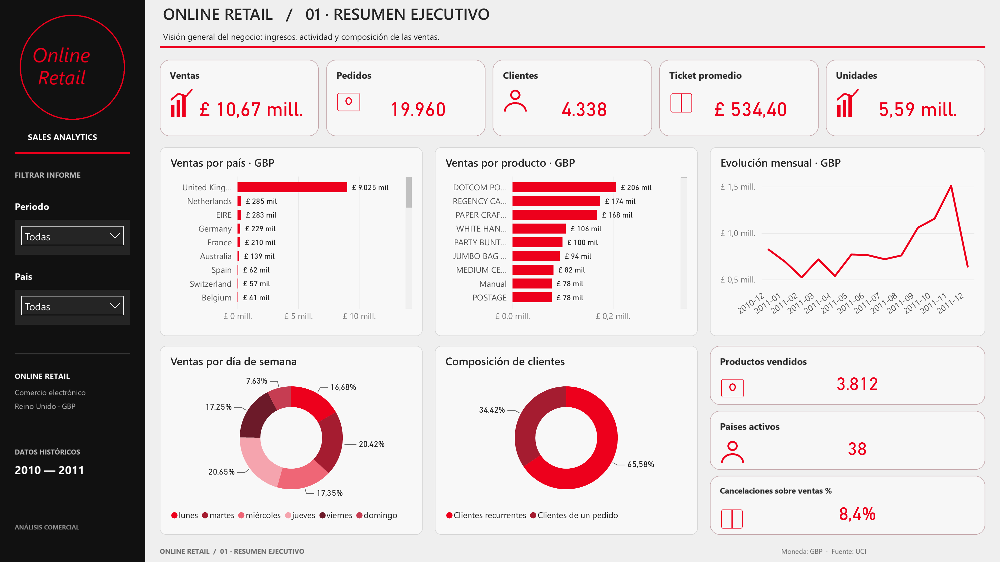
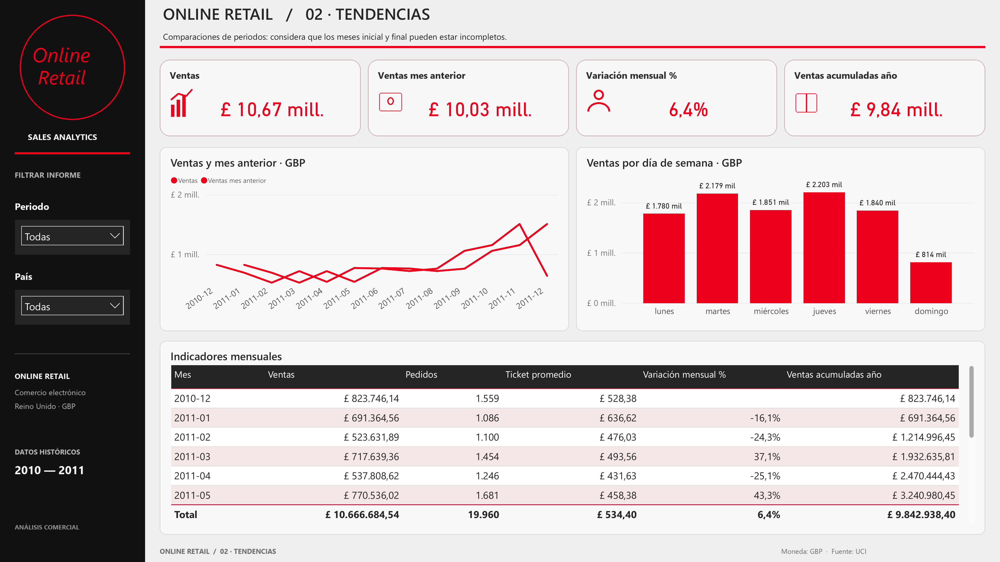
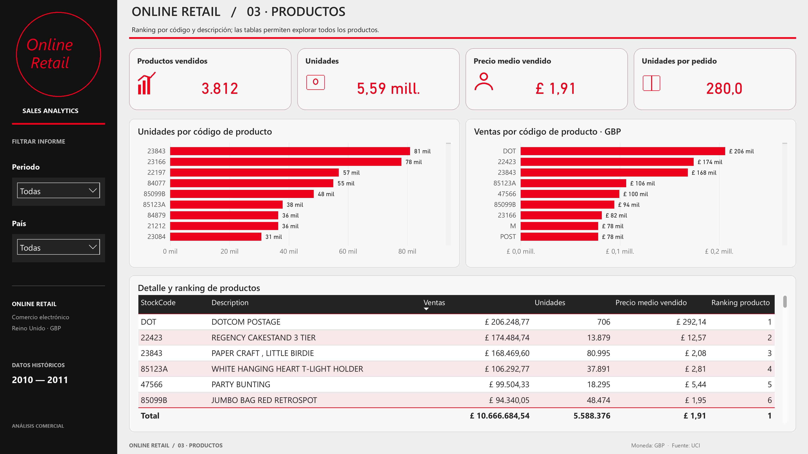
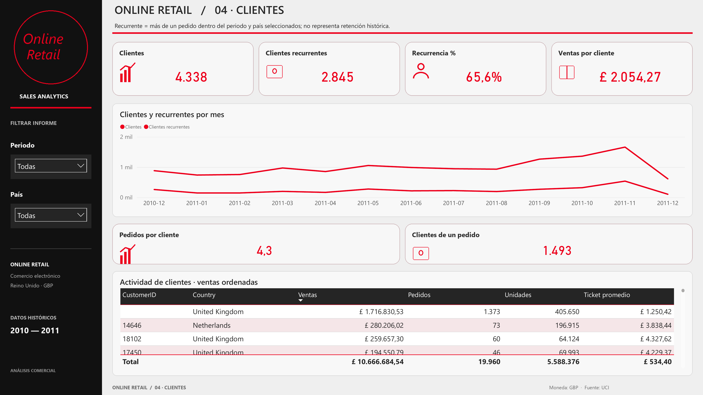
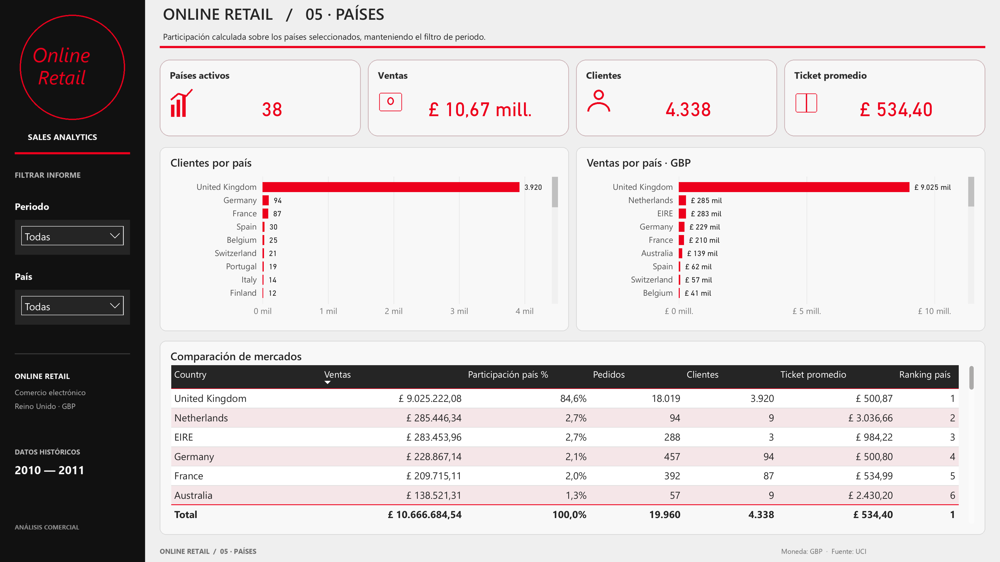
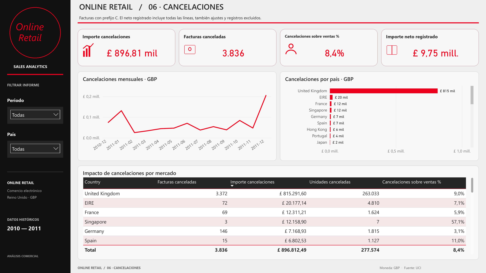
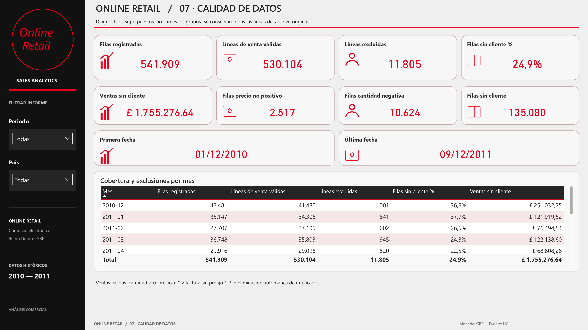

# Online Retail · Power BI

**Dashboard de análisis comercial de Cynthia Vanessa**, con siete páginas para explorar ventas, tendencias, productos, clientes, países, cancelaciones y calidad de los datos.

Diseño panorámico con barra lateral negra, tarjetas con iconos y cifras rojas, gráficos en tonos rojos y tablas de detalle. La paleta se inspira en una referencia visual de Coca-Cola; la identidad y los datos del proyecto corresponden a **Online Retail**.

**Ver con más detalle:** [abrir el informe completo en PDF](docs/Retail.pdf) · [abrir la portada en alta resolución](docs/screenshots/01-resumen-ejecutivo.png).

## El proyecto en cifras

Resultados generales del informe, sin filtros de periodo ni país:

| Indicador | Resultado |
|---|---:|
| Ventas válidas | £10.666.684,54 |
| Pedidos | 19.960 |
| Clientes identificados | 4.338 |
| Unidades vendidas | 5.588.376 |
| Códigos de producto vendidos | 3.812 |
| Países activos | 38 |
| Ticket promedio | £534,40 |
| Filas en el archivo original | 541.909 |

Todas las cifras monetarias están expresadas en **libras esterlinas (GBP)**.

## Recorrido por las siete pantallas

Las siete imágenes se generaron directamente desde el PDF exportado por Power BI, a **4.000 × 2.250 píxeles** cada una. Haz clic en una imagen para abrirla a tamaño completo y ampliar los textos y las tablas. También puedes [abrir o descargar el PDF de las siete páginas](docs/Retail.pdf).

### 01 · Resumen ejecutivo

Reúne las ventas, los pedidos, los clientes, el ticket promedio y las unidades. Compara países y productos, muestra la evolución mensual y presenta la distribución por día de semana y la composición de clientes recurrentes y de un solo pedido.

### 02 · Tendencias

Compara las ventas con el mes anterior, presenta la variación mensual y el acumulado del año, y permite consultar el detalle por mes y las ventas por día de semana.

### 03 · Productos

Analiza códigos de producto, unidades, precio medio y unidades por pedido. Los gráficos y la tabla permiten explorar el ranking de ventas. La fuente también contiene conceptos como portes y ajustes, por lo que los códigos no representan exclusivamente artículos físicos.

### 04 · Clientes

Muestra clientes identificados, recurrencia, ventas por cliente y pedidos por cliente. La tabla presenta las ventas y los pedidos de cada identificador; la fila sin identificador permite reconocer la actividad que no puede atribuirse a un cliente concreto.

### 05 · Países

Compara ventas y clientes por país e incluye participación, pedidos, ticket promedio y ranking para explorar los mercados presentes en el archivo.

### 06 · Cancelaciones

Presenta los importes y las facturas canceladas, su relación con las ventas, la evolución mensual y el impacto por país. También muestra el importe neto registrado.

### 07 · Calidad de datos

Expone las filas registradas, las líneas válidas y excluidas, la ausencia de identificadores de cliente, los precios no positivos, las cantidades negativas y la cobertura temporal.

## Qué se hizo

- Transformación de los datos con **Power Query**: tipos de datos, fecha, mes, importe por línea y clasificación de ventas válidas.
- Modelo con las tablas principales **Ventas** y **Calendario**, relacionadas por fecha.
- **39 medidas DAX** para indicadores comerciales, comparación temporal, clientes, geografía, productos, cancelaciones y calidad.
- Filtros de periodo y país independientes por página; tablas y gráficos interactivos con acceso al detalle.
- Rediseño de las siete páginas en formato **16:9**, con una composición uniforme y recursos gráficos incorporados al informe.
- Revisión visual en Power BI Desktop y comprobaciones de estructura, referencias de campos, límites y ausencia de solapamientos entre visuales de datos.

## Cómo abrirlo

1. Descarga el repositorio completo con **Code → Download ZIP**, o clónalo.
2. Descomprime el archivo y abre [`PowerBI_Profesional/Retail.pbip`](PowerBI_Profesional/Retail.pbip) en Power BI Desktop, con soporte para proyectos `.pbip`.
3. En **Transformar datos → Administrar parámetros**, cambia **`RutaExcel`** por la ruta completa del archivo [`data/Online Retail.xlsx`](data/Online%20Retail.xlsx) en tu equipo.
4. Aplica los cambios y selecciona **Actualizar** para cargar los datos.
5. Si lo necesitas, guarda una copia como `.pbix` desde Power BI Desktop.

Mantén las carpetas `Retail.Report` y `Retail.SemanticModel` junto a `Retail.pbip`. El repositorio incluye la definición del proyecto y el Excel; la caché local de Power BI se genera al actualizar.

## Archivos principales

| Ruta | Contenido |
|---|---|
| [`PowerBI_Profesional/Retail.pbip`](PowerBI_Profesional/Retail.pbip) | Archivo de apertura del proyecto |
| [`PowerBI_Profesional/Retail.Report`](PowerBI_Profesional/Retail.Report) | Siete páginas, visuales, tema y fondos |
| [`PowerBI_Profesional/Retail.SemanticModel`](PowerBI_Profesional/Retail.SemanticModel) | Modelo, consultas y medidas DAX |
| [`PowerBI_Profesional/Medidas_DAX.txt`](PowerBI_Profesional/Medidas_DAX.txt) | Referencia de las fórmulas |
| [`PowerBI_Profesional/Tema_Retail.json`](PowerBI_Profesional/Tema_Retail.json) | Paleta y estilos del tema |
| [`data/Online Retail.xlsx`](data/Online%20Retail.xlsx) | Datos originales |
| [`docs/screenshots`](docs/screenshots) | Capturas de las siete páginas |
| [`docs/Retail.pdf`](docs/Retail.pdf) | Exportación completa para consultar y ampliar |

## Criterios de interpretación

**Ventas válidas:** cantidad y precio positivos y factura sin prefijo `C`. El importe es cantidad × precio. No se eliminan duplicados automáticamente.

**Clientes:** los identificadores vacíos se incluyen en las ventas generales, pero se excluyen de los indicadores de clientes identificados. Un cliente recurrente tiene más de un pedido dentro de la selección actual; esta medida no representa retención histórica.

**Cancelaciones:** se identifican por el prefijo `C`, sin asociarlas a una venta original. El porcentaje sobre ventas no es una tasa de devoluciones por cohorte. El neto registrado incluye todas las líneas y ajustes.

**Tiempo y calidad:** el archivo cubre del 1 de diciembre de 2010 al 9 de diciembre de 2011. Los meses inicial y final son parciales. Las categorías de calidad pueden superponerse. No se calculan márgenes ni beneficios porque la fuente no aporta costes.

## Fuente y atribución

Chen, D. (2015). **Online Retail** [Dataset]. UCI Machine Learning Repository. [DOI: 10.24432/C5BW33](https://doi.org/10.24432/C5BW33).

Los datos se distribuyen bajo [CC BY 4.0](https://creativecommons.org/licenses/by/4.0/). El Excel se conserva sin modificaciones; las transformaciones se realizan dentro del modelo de Power BI. Consulta la [ficha original](https://archive.ics.uci.edu/dataset/352/online%2Bretail) y la [atribución del archivo](data/FUENTE.md).

La fuente describe una empresa británica de comercio electrónico dedicada principalmente a artículos de regalo y no publica su nombre. Este proyecto no está afiliado a Coca-Cola.

**Autora del informe:** [CynthiaVanessa18](https://github.com/CynthiaVanessa18).
